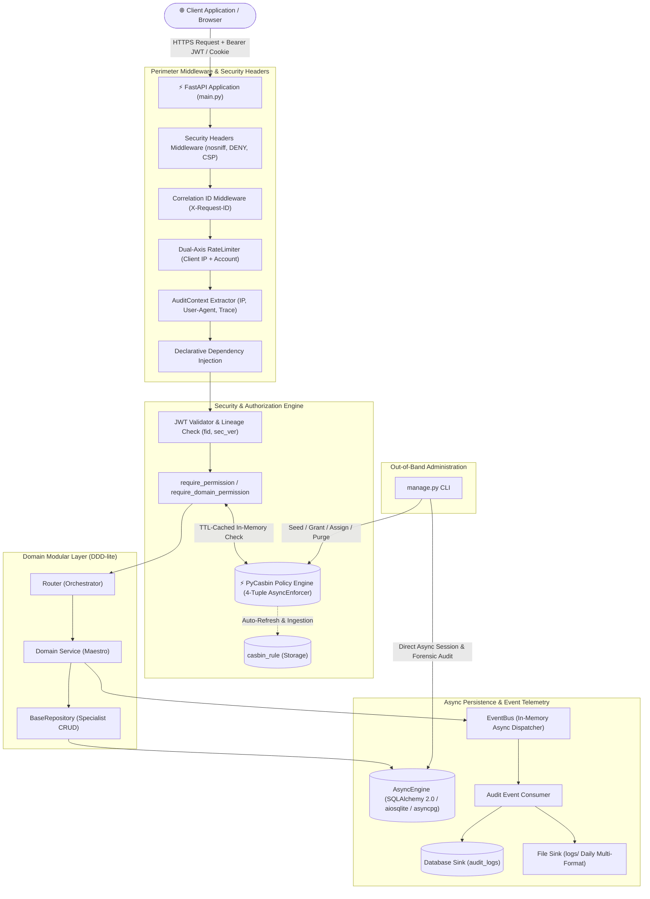

<div align="center">
  <h1>🚀 Enterprise FastAPI Base Foundation</h1>
  <p>
    <strong>Hardened, asynchronous backend foundation with PyCasbin RBAC, DDD-lite modularity, and zero-trust security.</strong>
  </p>

  <p>
    <a href="https://www.python.org/downloads/"></a>
    <a href="https://fastapi.tiangolo.com"></a>
    <a href="https://www.sqlalchemy.org/"></a>
    <a href="https://casbin.org/"></a>
    <a href="https://docs.astral.sh/uv/"></a>
    <a href="LICENSE"></a>
    
  </p>

  <p>
    <a href="#-system-architecture">Architecture</a> ·
    <a href="#-key-capabilities">Key Features</a> ·
    <a href="#-quickstart-guide">Quickstart</a> ·
    <a href="#-api-specification">API Spec</a> ·
    <a href="#-administrative-cli">Admin CLI</a> ·
    <a href="#-automated-testing">Testing</a>
  </p>

  <p>
    🌐 <strong><a href="README_AR.md">النسخة العربية (README_AR.md)</a></strong>
  </p>
</div>

---

## 🏛 System Architecture

The foundation employs a **Domain-Driven Design (DDD-lite)** modular monolith pattern combined with the **Orchestrator-Specialist** behavioral contract:



### Declarative API Security in Practice
Endpoints are protected with atomic, readable dependency factories without polluting business logic:

```python
@router.get(
    "",
    response_model=PaginatedResponse[UserResponse],
    dependencies=[Depends(require_permission(resource=Resource.USERS, action=Action.READ))],
)
async def list_users_endpoint(
    pagination: PaginationParams = Depends(),
    session: SessionDep = None,
) -> PaginatedResponse[UserResponse]:
    users, total = await service.list_users(
        session=session,
        offset=pagination.offset,
        limit=pagination.page_size,
    )
    return PaginatedResponse(
        data=[UserResponse.model_validate(u) for u in users],
        pagination=PaginationMeta.from_params(
            page=pagination.page,
            page_size=pagination.page_size,
            total=total,
        ),
    )
```

---

## 💡 Overview & Why This Foundation?

Building production-ready backend services requires solving complex cross-cutting challenges before writing a single line of business logic: **authentication session invalidation**, **fine-grained role-based access control**, **observable structured audit logging**, **reliable database migrations**, and **safe administrative bootstrapping**.

This repository provides an enterprise-hardened blueprint designed to eliminate architectural debt:
* **Decoupled 4-Tuple Authorization:** Moves beyond crude, hardcoded role checks (`if user.role == 'admin'`) into dynamic, resource-action authorization driven by **PyCasbin** with domain isolation (`sub, dom, obj, act`).
* **Zero-Trust Token Revocation:** Prevents zombie sessions when passwords change via an atomic `security_version` counter and cryptographically linked family lineage (`fid`) embedded in JWT claims.
* **Separation of Concerns:** Strict adherence to the Orchestrator-Specialist pattern keeps HTTP routers lightweight, domain services cohesive, and database repositories generic and reusable.
* **Asynchronous First:** Built entirely on native `async`/`await` primitives across the network stack, database driver, and policy engine for maximum throughput.

---

## ⚡ Key Capabilities

- 🛡️ **Zero-Trust Granular RBAC (PyCasbin 4-Tuple):** Sub-millisecond policy evaluation evaluated in-memory with automatic TTL cache refresh (`AUTHZ_CACHE_TTL_SECONDS`). Supports role inheritance, wildcards (`*`), domain isolation, and fail-closed abstract domain resolvers (`DomainAccessResolver`).
- 🔐 **Dual-Token Session Lifecycle & Replay Defense:** Issues short-lived access tokens (30 minutes) and revocable refresh tokens (30 days). Cryptographic JTI tracking in `refresh_sessions` with state-of-the-art Argon2id password hashing. Implements RFC 9700 §4.14.2 replay attack detection that revokes entire compromised lineages while preserving other device sessions (smart device isolation).
- 🍪 **Dual-Mode Auth Transport & Strict Anti-CSRF:** Supports both `cookie` (HttpOnly, SameSite, Secure) and `json` transports. When `auth_transport_mode="cookie"`, sensitive refresh tokens are stripped from response bodies, and incoming cookie requests are strictly validated against allowed origins via literal `urlsplit` scheme/host parsing.
- 🚦 **Dual-Axis Sliding-Window Rate Limiting:** In-memory sliding window rate limiter with $\mathcal{O}(1)$ LRU eviction capped at `RATE_LIMIT_MAX_TRACKED_KEYS` (10,000 keys) to prevent memory exhaustion DoS. Throttles requests simultaneously across client IP and account identifier to defeat distributed credential stuffing.
- ⚡ **Native Asynchronous Persistence (SQLAlchemy 2.0):** Pure async I/O via `AsyncEngine` and `async_sessionmaker`. Generic `BaseRepository[Model]` provides standardized CRUD operations while supporting both SQLite (`aiosqlite`) and PostgreSQL (`asyncpg`), with query parameters automatically masked (`hide_parameters=True`).
- 📜 **Version-Controlled Database Evolution (Alembic):** Standardized constraint naming conventions (`ix_`, `uq_`, `ck_`, `fk_`, `pk_`) eliminate dialect inconsistencies. Zero runtime DDL generation in production with deterministic schema synchronization checks.
- 🕵️ **Multi-Sink Audit Logging & Telemetry:** Event-driven telemetry via in-memory `EventBus`. Simultaneously streams forensic audit records to relational tables and high-speed disk logs in strict NDJSON format. Includes client IP extraction (`X-Forwarded-For`), User-Agent tracking, before/after state diffs, and strict credential redaction (`[REDACTED]`).
- 🖥️ **Interactive API Workbench UI (`/ui`):** Built-in real-time developer workbench and security lab mounted conditionally in non-production environments (`ENABLE_DOCS_AND_UI`). Features credential redaction in network inspectors and volatile `sessionStorage` token isolation.
- 🛡️ **Hardened Perimeter & Security Headers:** Enforces `Content-Security-Policy`, `X-Content-Type-Options: nosniff`, `X-Frame-Options: DENY`, and `Referrer-Policy: strict-origin-when-cross-origin`. Environment-aware defaults automatically shut down Swagger UI, ReDoc, and public user registration in hardened modes (`staging`, `pro`, `prod`).
- 🧰 **Out-of-Band Administrative CLI (`manage.py`):** Standalone operations CLI to seed baseline permissions, create root administrators, assign/unassign roles, and purge expired tombstones—complete with forensic audit trail logging.

---

## 🛠 Technology Stack

| Layer | Component | Version / Standard | Purpose |
| :--- | :--- | :--- | :--- |
| **Runtime & Toolchain** | [Python](https://www.python.org/) / [uv](https://docs.astral.sh/uv/) | `Python 3.13+` / `uv >= 0.5` | High-performance runtime and deterministic package management |
| **Web Framework** | [FastAPI](https://fastapi.tiangolo.com/) | `>= 0.141.1` | ASGI web routing, dependency injection, and OpenAPI contract generation |
| **Data & Serialization** | [Pydantic V2](https://docs.pydantic.dev/) | `>= 2.13.4` | Boundary schema validation, settings management (`pydantic-settings`) |
| **ORM & Database** | [SQLAlchemy 2.0](https://www.sqlalchemy.org/) | `>= 2.0.52 (Async)` | Async ORM, declarative mapping, and repository abstraction |
| **Database Drivers** | `aiosqlite` / `asyncpg` | `>= 0.22` / `>= 0.31` | High-throughput asynchronous drivers for SQLite and PostgreSQL |
| **Schema Migrations** | [Alembic](https://alembic.sqlalchemy.org/) | `>= 1.19.1` | Asynchronous migration pipeline with automated constraint naming |
| **Policy Engine** | [PyCasbin](https://casbin.org/) | `>= 1.43.0` | In-memory dynamic 4-tuple RBAC authorization engine |
| **Cryptography** | [pwdlib[argon2]](https://github.com/frankie567/pwdlib) / [PyJWT](https://pyjwt.readthedocs.io/) | `>= 0.3.1` / `>= 2.13.0` | Argon2id password hashing and HS256 JWT encoding/decoding |
| **Testing** | [pytest](https://pytest.org/) / [httpx](https://www.python-httpx.org/) | `>= 9.1` / `>= 0.28` | Async integration test suite running 106 automated test scenarios |

---

## 🚀 Quickstart Guide

Get the server running locally in under two minutes:

### 1. Prerequisites
Ensure you have Python 3.13+ and [`uv`](https://docs.astral.sh/uv/) installed:
```bash
# Install uv (Windows PowerShell)
powershell -ExecutionPolicy ByPass -c "irm https://astral.sh/uv/install.ps1 | iex"

# Install uv (Linux / macOS)
curl -LsSf https://astral.sh/uv/install.sh | sh
```

### 2. Clone & Sync Dependencies
```bash
git clone <repository-url>
cd fastapi-base-foundation
uv sync --frozen
```

### 3. Configure Environment
Initialize the environment configuration file:
```bash
cp .env.example .env
```
*(The default `.env` is pre-configured for local SQLite development and automatically generates secure transient keys in memory).*

### 4. Run Migrations & Seed Baseline Authorization
```bash
# Apply database schema
uv run alembic upgrade head

# Ingest default Casbin authorization policies
uv run python manage.py seed-policies
```

### 5. Launch Development Server
```bash
uv run uvicorn main:app --reload --host 127.0.0.1 --port 8000
```

### 6. Verify Health
```bash
curl http://127.0.0.1:8000/health
# Output: {"status":"ok","version":"1.0.0","environment":"dev"}

curl http://127.0.0.1:8000/health/ready
# Output: {"status":"ok","checks":{"database":"ok"}}
```

---

## 📖 API Specification & Interactive Docs

In development and test environments (`ENABLE_DOCS_AND_UI=true`), interactive documentation and tools are available at:
* **Interactive Workbench UI:** [http://127.0.0.1:8000/ui](http://127.0.0.1:8000/ui)
* **Swagger UI:** [http://127.0.0.1:8000/docs](http://127.0.0.1:8000/docs)
* **ReDoc:** [http://127.0.0.1:8000/redoc](http://127.0.0.1:8000/redoc)

> [!NOTE]
> In hardened production environments (`staging`, `pro`, `prod`), `/ui`, `/docs`, `/redoc`, and `/openapi.json` are automatically disabled by default to minimize attack surface.

### Core Endpoints Overview

| Method | Path | Permission Required | Description |
| :--- | :--- | :--- | :--- |
| `POST` | `/api/v1/auth/register` | *Public (Rate-limited, Gated)* | Register a new user (gated by `ALLOW_PUBLIC_REGISTRATION`) |
| `POST` | `/api/v1/auth/login` | *Public (Rate-limited IP+Account)* | Authenticate and obtain Access & Refresh tokens |
| `POST` | `/api/v1/auth/refresh` | *Public (Refresh Token, Rate-limited)* | Rotate refresh token and issue fresh access token |
| `POST` | `/api/v1/auth/logout` | Authenticated | Revoke current device refresh session |
| `POST` | `/api/v1/auth/logout-all` | Authenticated | Instantly revoke all active device sessions for current user |
| `POST` | `/api/v1/auth/change-password` | Authenticated | Change password & globally invalidate all sessions (`security_version`) |
| `GET` | `/api/v1/users/me` | Authenticated | Fetch current authenticated user profile |
| `GET` | `/api/v1/users` | `users:read` | List paginated users with deterministic sorting |
| `GET` | `/api/v1/users/{id}` | `users:read` or Self | Retrieve specific user by ID |
| `PATCH` | `/api/v1/users/{id}` | `users:update` or Self | Partially update user profile (rejects explicit nulls) |
| `GET` | `/api/v1/audit/logs` | `audit:read` | Query structured audit events with dynamic filters |
| `GET` | `/api/v1/audit/users/{user_id}/logs` | `audit:read` or Self | Query audit events scoped to a specific user |
| `GET` | `/api/v1/audit/export` | `audit:export` | Export audit trail as `JSON`, `TXT`, or `MARKDOWN` |
| `GET` | `/api/v1/audit/users/{user_id}/export` | `audit:export` or Self | Export audit records for a specific user |
| `GET` | `/health` | *Public* | Kubernetes un-enveloped liveness probe |
| `GET` | `/health/ready` | *Public* | Kubernetes database connectivity readiness probe |
| `GET` | `/ui` | *Public (Dev/Test only)* | Redirects to `/ui/` developer workbench |

---

## 🧰 Administrative CLI (`manage.py`)

The repository includes a dedicated out-of-band CLI tool to manage policies and administrator credentials directly without exposing public HTTP endpoints. Every administrative command generates forensic audit log entries with `actor_id="cli:<username>"`.

> 📘 **Full Documentation:** See [manage.md](manage.md) for the complete English reference manual, or [manage_ar.md](manage_ar.md) for Arabic.

```bash
# Seed default authorization rules (admin, global, *, *)
uv run python manage.py seed-policies

# Create initial root administrator (prompts for password securely)
uv run python manage.py create-admin --email "admin@enterprise.io" --name "Root Admin"

# Promote an existing user to admin
uv run python manage.py promote-admin --email "user@enterprise.io"

# Grant permission to a role in a domain
uv run python manage.py grant auditor audit read --domain global
uv run python manage.py grant auditor audit export --domain global

# Bind a role to a user identifier
uv run python manage.py assign-role 5 auditor --domain global

# Unassign a role from a user identifier
uv run python manage.py unassign-role 5 auditor --domain global

# Inspect active permissions and role groupings
uv run python manage.py list-policies

# Revoke permission from a role (requires --force for admin * *)
uv run python manage.py revoke auditor audit export --domain global

# Purge expired refresh session tombstones
uv run python manage.py purge-sessions --older-than-days 30
```

---

## ⚙️ Configuration & Environment Variables

Settings are managed via `pydantic-settings` with automatic type casting, environment override, and production safety guards:

| Variable | Type | Default | Hardened Requirement | Description |
| :--- | :--- | :--- | :--- | :--- |
| `ENVIRONMENT` | `str` | `dev` | **Required** | Runtime mode (`dev`, `test`, `staging`, `pro`, `prod`). |
| `DATABASE_URL` | `str` | `sqlite+aiosqlite:///./database.db` | **Yes** | Async connection string (`sqlite+aiosqlite://...` or `postgresql+asyncpg://...`). |
| `ACCESS_SECRET_KEY` | `str` | *Auto-generated in DEV* | $\ge 32$ chars, $\ge 10$ unique chars | Cryptographic secret for signing access tokens. |
| `REFRESH_SECRET_KEY` | `str` | *Auto-generated in DEV* | $\ge 32$ chars, $\ge 10$ unique chars | Cryptographic secret for signing refresh tokens (must differ from access key). |
| `ALGORITHM` | `str` | `HS256` | Must be supported | JWT signing algorithm (`HS256`, `HS384`, `HS512`). |
| `ACCESS_TOKEN_EXPIRES_MINUTES` | `int` | `30` | No | Lifetime duration of access tokens in minutes. |
| `REFRESH_TOKEN_EXPIRES_DAYS` | `int` | `30` | No | Lifetime duration of refresh tokens in days. |
| `AUTH_TRANSPORT_MODE` | `str` | `dual` | `dual`, `cookie`, or `json` | Transport mode for refresh tokens (`dual`, `cookie`, `json`). |
| `REFRESH_COOKIE_NAME` | `str` | `refresh_token` | No | Cookie name for refresh token storage. |
| `REFRESH_COOKIE_SECURE` | `bool` | `None` (Env-aware) | **Must be `true`** in hardened modes | Enforces `Secure` flag on refresh cookies. |
| `REFRESH_COOKIE_SAMESITE` | `str` | `lax` | `lax`, `strict`, `none` | SameSite attribute (`none` requires `secure=true`). |
| `REFRESH_COOKIE_PATH` | `str` | `/api/v1/auth` | No | Path restriction for the refresh token cookie. |
| `ALLOW_PUBLIC_REGISTRATION` | `bool` | `None` (Env-aware) | Defaults to `false` in hardened | Enable/disable public `/api/v1/auth/register`. |
| `ENABLE_DOCS_AND_UI` | `bool` | `None` (Env-aware) | Defaults to `false` in hardened | Enable/disable `/docs`, `/redoc`, and `/ui`. |
| `SECURITY_HEADERS_ENABLED` | `bool` | `true` | Recommended `true` | Injects CSP, X-Frame-Options, nosniff, Referrer-Policy headers. |
| `RATE_LIMIT_ENABLED` | `bool` | `true` | Recommended `true` | Enables sliding window dual-axis rate limiting. |
| `AUTH_RATE_LIMIT_REQUESTS` | `int` | `10` | No | Maximum requests per client within rate limit window. |
| `AUTH_RATE_LIMIT_WINDOW_SECONDS` | `int` | `60` | No | Sliding window size in seconds. |
| `RATE_LIMIT_MAX_TRACKED_KEYS` | `int` | `10000` | $100 \le N \le 100000$ | Maximum tracked keys in LRU history cache to cap memory usage. |
| `AUTHZ_CACHE_TTL_SECONDS` | `int` | `5` | No | TTL cache interval for PyCasbin in-memory policy invalidation. |
| `ALLOWED_ORIGINS` | `list[str]` | `["*"]` (in DEV) | Wildcard `*` strictly banned | Permitted CORS origins (JSON array or comma-separated). |
| `TRUST_PROXY_HEADERS` | `bool` | `false` | No | Trust reverse proxy headers (`X-Forwarded-For`) for client IP resolution. |
| `TRUSTED_PROXIES` | `list[str]` | `[]` | Required if trust=true | Explicit IP addresses or CIDR blocks authorized as trusted upstream proxies. |
| `LOG_TO_DB` | `bool` | `true` | No | Enable or disable persisting audit events to the database. |
| `LOG_TO_FILE` | `bool` | `true` | No | Enable or disable writing structured audit logs to daily disk sinks. |
| `LOG_DIR` | `str` | `logs` | No | Destination directory for daily audit log rotation (`.json`, `.txt`, `.md`). |

> [!CAUTION]
> In hardened environments (`staging`, `pro`, `prod`), the application enforces that secrets are explicitly defined, not placeholders, have sufficient entropy, that CORS origins do not contain wildcards (`*`), that `REFRESH_COOKIE_SECURE` is not `false`, and that `ECHO` and `RELOAD` are disabled. Startup fails immediately if any condition is violated.

---

## 📂 Project Structure

The project structure adheres strictly to DDD-lite domain boundaries and mirrors the test hierarchy:

```
fastapi-base-foundation/
├── .github/
│   └── workflows/ci.yml         # Automated CI matrix (uv sync, alembic check, pytest)
├── main.py                     # Application factory, lifespan, security headers & exception handlers
├── manage.py                   # Out-of-band administrative CLI (superusers, policy seeding, forensic audit)
├── manage.md                   # Full CLI operation manual (English)
├── manage_ar.md                # Full CLI operation manual (Arabic)
├── pyproject.toml              # Project metadata, dependencies & tool configs (uv managed)
├── alembic.ini                 # Alembic migration engine configuration
├── .env.example                # Documented environment variable template
├── LICENSE                     # MIT License file
├── migrations/                 # Asynchronous database migration environment
│   ├── env.py                  # Migration runner with dynamic settings & metadata discovery
│   ├── script.py.mako          # Async revision template
│   ├── README.md               # Migration manual & database purge guide (English)
│   ├── README_AR.md            # Migration manual & database purge guide (Arabic)
│   └── versions/               # Deterministic, version-controlled migration files
├── static/                     # Interactive Developer Workbench & Security Lab (/ui)
│   ├── index.html              # Single-page developer workbench application
│   └── js/                     # Modular frontend client with token isolation & credential redaction
├── src/
│   ├── database/               # Asynchronous persistence infrastructure
│   │   ├── base.py             # DeclarativeBase with standardized constraint naming conventions
│   │   ├── base_repo.py        # Generic BaseRepository[Model] (Async CRUD specialist)
│   │   ├── engine.py           # AsyncEngine with hide_parameters=True & pool lifecycle
│   │   └── session.py          # Asynchronous database session dependency provider
│   ├── exc/                    # Domain exception hierarchy (AppException & standard error codes)
│   ├── modules/                # Self-contained domain modules (DDD-lite)
│   │   ├── auth/               # Authentication, token rotation, sessions & change-password
│   │   │   ├── dependencies.py # get_current_user & require_permission declarative factories
│   │   │   ├── events.py       # Auth domain event definitions
│   │   │   ├── model.py        # RefreshSession ORM entity with JTI & family_id tracking
│   │   │   ├── repo.py         # RefreshSessionRepository with fail-closed lineage verification
│   │   │   ├── router.py       # Authentication HTTP endpoints (rate-limited, dual-mode transport)
│   │   │   ├── schemas.py      # Request/response validation contracts
│   │   │   └── service.py      # Auth business logic maestro with RFC 9700 replay protection
│   │   ├── user/               # User account domain
│   │   │   ├── events.py       # User domain event definitions
│   │   │   ├── exc.py          # User domain specific exceptions
│   │   │   ├── model.py        # User ORM entity with security_version counter
│   │   │   ├── repo.py         # UserRepository specialist
│   │   │   ├── router.py       # User management endpoints (paginated, partial updates)
│   │   │   └── service.py      # User business logic maestro
│   │   └── audit/              # Security audit logging subsystem
│   │       ├── listeners/      # Domain event subscribers (Auth & User event listeners)
│   │       ├── model.py        # AuditLog ORM entity with composite indexes
│   │       ├── repo.py         # Append-only AuditLogRepository specialist
│   │       ├── router.py       # Audit query and export endpoints
│   │       ├── formatters.py   # Multi-format export formatters (JSON, TXT, MARKDOWN)
│   │       └── service.py      # Multi-sink audit logger maestro (DB + NDJSON File Sinks)
│   ├── security/               # Cryptography & dynamic authorization engine
│   │   ├── authorization.py    # AuthorizationService facade wrapping PyCasbin 4-tuple enforcer
│   │   ├── casbin_rule.py      # CasbinRule ORM entity
│   │   ├── guards.py           # Abstract DomainAccessResolver protocol & domain guards
│   │   ├── rbac_model.conf     # Casbin 4-tuple RBAC model specification
│   │   └── security.py         # Password hashing (Argon2id) & JWT token encoders
│   ├── settings/               # Environment settings validation (Pydantic Settings)
│   └── share/                  # Shared primitives (Enums, RateLimiter, EventBus, Response Envelopes)
│       ├── enum.py             # Roles, Resource, Action, Severity enums
│       ├── event_bus.py        # In-memory asynchronous domain event dispatcher
│       ├── helpers.py          # Proxy IP resolution & audit context extractors
│       ├── limits.py           # Hard architectural boundary limits & payload bounds
│       ├── rate_limit.py       # Dual-axis sliding window RateLimiter with O(1) LRU eviction
│       └── responses.py        # Standardized SuccessResponse, PaginatedResponse, ErrorResponse
└── tests/                      # Automated test suite (106 test scenarios, source-mirrored)
    ├── __init__.py             # Test package root
    ├── conftest.py             # Shared fixtures (make_access_token, db_session, client)
    ├── support/                # Internal test support infrastructure (database, paths)
    ├── app/                    # Web layer tests (error envelopes, health, input hardening, middleware, UI)
    ├── cli/                    # CLI manage.py operational tests
    ├── contracts/              # Cross-cutting enterprise release gate contracts (RG-01 to RG-15)
    ├── database/               # Database engine & BaseRepository tests
    ├── migrations/             # Alembic migration linearity & schema drift verification
    ├── settings/               # Settings validation & entropy tests
    ├── share/                  # Shared components tests (EventBus, IP helpers, RateLimiter)
    ├── security/               # Security, Casbin RBAC, guards, and cryptography tests
    ├── modules/                # Domain module tests
    │   ├── auth/               # Auth flow, session hardening, transport/CSRF, events, password change
    │   ├── user/               # User CRUD, pagination edges, RBAC, events
    │   └── audit/              # Audit logging, database-disabled sinks, model immutability
    ├── README.md               # Test documentation (English)
    └── README_AR.md            # Test documentation (Arabic)
```

---

## 🧪 Automated Testing

The project maintains **100% test pass rate** with 106 automated test scenarios covering the full API contract, security boundaries, and edge cases against an isolated in-memory SQLite database:

```bash
# Run all tests with concise or verbose output
uv run --frozen pytest -q
uv run --frozen pytest -v

# Run enterprise release-gate verification suite (15 contracts: RG-01 to RG-15)
uv run --frozen pytest -m release_gate -v

# Run V1 security audit regression suite (18 security tests: SEC-01 to SEC-18)
uv run --frozen pytest -m security_audit -v

# Run targeted module test directories
uv run --frozen pytest tests/modules/auth -v
uv run --frozen pytest tests/security -v
uv run --frozen pytest tests/app -v
```

### 🛡️ Enterprise Security Hardening & Release Gate Contracts

| Gate ID | Invariant & Architectural Contract | Defense & Standard |
|---|---|---|
| **RG-01** | Single unified Alembic head with zero schema drift | Idempotent migrations + autogenerate check |
| **RG-02** | Function-scoped transaction boundary (`SessionDep`) | Eliminates uncommitted response leakage |
| **RG-03** | Strict JWT profiles (SubjectIntStr, `fid`, `sec_ver`) | Uniform 401 Unauthorized responses |
| **RG-04** | Transactional audit file commit hooks (`after_commit`) | Rolled back transactions never write success logs |
| **RG-05** | Refresh token carries and enforces actual `security_version` | Prevents token reuse across version upgrades |
| **RG-06** | Immediate access & refresh token revocation on logout | Smart device isolation preserves other sessions |
| **RG-07** | Ancestor token logout revokes entire lineage family | Mitigates stale ancestor token retention |
| **RG-08** | Atomic CAS replay detection revokes family immediately | RFC 9700 §4.14.2 token replay protection |
| **RG-09** | Purge preserves unexpired revoked tombstones | Retains cryptographic evidence for replay detection |
| **RG-10** | Comprehensive auth lifecycle audit coverage | Correlates `request_id`, client IP, and outcomes |
| **RG-11** | Append-only repository immutability enforcement | Audit records cannot be updated or deleted |
| **RG-12** | User-scoped session family revocation | Eliminates cross-tenant session disruption |
| **RG-13** | Constant-time async dummy password verification | Mitigates timing attacks on unregistered emails |
| **RG-14** | Dual-party actor/target tracking with automated redaction | Redacts credentials, secrets, and auth tokens |
| **RG-15** | Atomic admin governance lock (`UPDATE ... WHERE role='admin'`) | Serializes deactivations & blocks last-admin lockout |

### 🔐 Security Audit Verification Matrix (V1.0.0)

| Security ID | Verified Security Finding & Hardening Invariant | Verification Suite Target |
|---|---|---|
| **SEC-01** | Strict URL-parsed scheme/host CSRF validation via `urlsplit` | `tests/modules/auth/test_transport_and_csrf.py` |
| **SEC-02** | Fail-closed session lineage validation and safe logout semantics | `tests/modules/auth/test_session_hardening.py` |
| **SEC-03** | Stripping of `refresh_token` from body in cookie auth mode | `tests/modules/auth/test_transport_and_csrf.py` |
| **SEC-04** | Dynamic in-memory dev secret keys & prod mandatory enforcement | `tests/settings/test_settings.py` |
| **SEC-05** | Ban wildcard `*` allowed origins in staging/hardened environments | `tests/settings/test_settings.py` |
| **SEC-06** | Enforce `REFRESH_COOKIE_SECURE=true` in hardened environments | `tests/settings/test_settings.py` |
| **SEC-07** | $\mathcal{O}(1)$ LRU cap on RateLimiter (10k keys) + dual-axis account throttling | `tests/share/test_rate_limit.py` |
| **SEC-08/09** | Credential redaction in Workbench inspector and volatile sessionStorage | `tests/app/test_ui_workbench.py` |
| **SEC-10** | Automated Casbin policy cache invalidation with 5s TTL | `tests/security/test_authorization.py` |
| **SEC-11** | Secret key entropy validation ($\ge 32$ chars, $\ge 10$ distinct chars) | `tests/settings/test_settings.py` |
| **SEC-12** | Database query parameter hiding and sanitized `IntegrityError` logging | `tests/modules/auth/test_session_hardening.py` |
| **SEC-15** | Fail-closed domain authorization on `DefaultGlobalDomainResolver` | `tests/security/test_guards.py` |
| **SEC-16** | Forensic audit trail logging for all administrative CLI commands | `tests/cli/test_manage.py` |
| **SEC-17/18** | Enterprise HTTP security headers and environment-aware docs/UI gate | `tests/app/test_middleware.py` |

> 📘 **Test Documentation:** See [tests/README.md](tests/README.md) and [tests/README_AR.md](tests/README_AR.md) for detailed test scenarios, contract envelopes, and architectural verification steps.

---

## 🛠 Developer Guide: Adding a New Domain Module

<details>
<summary><strong>Click to expand: 6-Step Guide to Adding a New Domain Module (e.g. Products)</strong></summary>

### Step 1: Create the Module Directory
```bash
mkdir src/modules/products
```

### Step 2: Define the ORM Entity (`src/modules/products/model.py`)
```python
from sqlalchemy import String
from sqlalchemy.orm import Mapped, mapped_column
from src.database.base import BaseModel
from src.database.mixin import DateTimeMixin

class Product(BaseModel, DateTimeMixin):
    __tablename__ = "products"

    id: Mapped[int] = mapped_column(primary_key=True, autoincrement=True)
    title: Mapped[str] = mapped_column(String(200), nullable=False)
```

### Step 3: Create the Repository Specialist (`src/modules/products/repo.py`)
```python
from sqlalchemy.ext.asyncio import AsyncSession
from src.database.base_repo import BaseRepository
from .model import Product

class ProductRepository(BaseRepository[Product]):
    def __init__(self, session: AsyncSession):
        super().__init__(class_=Product, session=session)
```

### Step 4: Register Protected Resource Enum (`src/share/enum.py`)
```python
class Resource(StrEnum):
    USERS = 'users'
    AUDIT = 'audit'
    PRODUCTS = 'products'  # Add new domain resource namespace
```

### Step 5: Implement Service Maestro & Router
* Implement business logic in `service.py`.
* Implement HTTP endpoints in `router.py` protected by `require_permission(Resource.PRODUCTS, Action.READ)`.
* Mount the router in `src/modules/__init__.py`.
* Import the `Product` entity in `migrations/env.py`.

### Step 6: Generate Migration & Add Domain Tests
```bash
# Generate and apply migration
uv run alembic revision --autogenerate -m "add_products_table"
uv run alembic upgrade head

# Add domain tests in tests/modules/products/
mkdir tests/modules/products
```
</details>

---

## ⚖️ Architectural Notes & Known Limitations

* **Multi-Worker Casbin Policy Synchronization:** The PyCasbin enforcer operates with in-memory policy caching for ultra-fast evaluations. Dynamic policy changes are automatically synchronized across all workers within a configurable 5-second window (`AUTHZ_CACHE_TTL_SECONDS=5`). For real-time sub-second propagation across distributed clusters, a distributed pub/sub watcher (e.g., Redis Pub/Sub) may be attached.
* **Audit Log Immutability Guard:** Append-only immutability for audit records is enforced at the repository layer (`AuditLogRepository`). In high-security production deployments, database-level immutability (e.g., database user privilege revocation on `UPDATE`/`DELETE` or append-only SQL triggers) should be enforced directly on the database engine.

---

## 📄 License & Contributing

This project is open-source and released under the [MIT License](LICENSE). Contributions, bug reports, and pull requests adhering to the repository's architectural principles are welcome.
