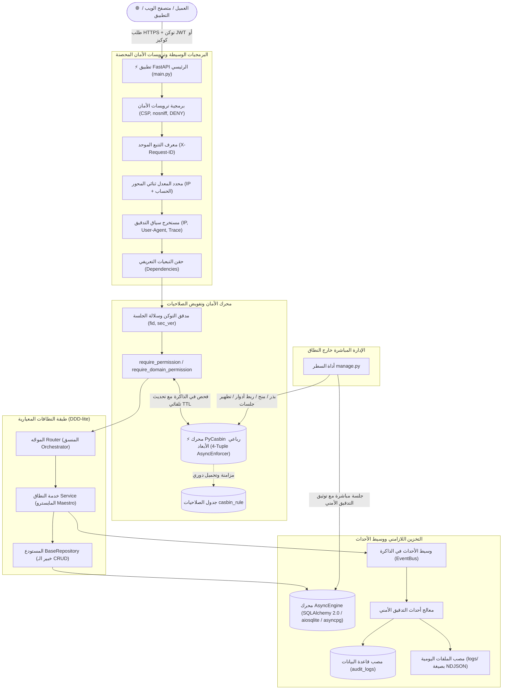

<div align="center">
  <h1>🚀 البنية التحتية القياسية لتطبيقات FastAPI للمؤسسات</h1>
  <p>
    <strong>قاعدة مشاريع خلفية فائقة الأداء، مؤمنة بالكامل بمحرك PyCasbin، ومعمارية موجهة بالنطاق (DDD-lite) ومبادئ انعدام الثقة (Zero-Trust).</strong>
  </p>

  <p>
    <a href="https://www.python.org/downloads/"></a>
    <a href="https://fastapi.tiangolo.com"></a>
    <a href="https://www.sqlalchemy.org/"></a>
    <a href="https://casbin.org/"></a>
    <a href="https://docs.astral.sh/uv/"></a>
    <a href="LICENSE"></a>
    
  </p>

  <p>
    <a href="#-المخطط-المعماري-للنظام">المعمارية</a> ·
    <a href="#-الميزات-والقدرات-الرئيسية">الميزات الرئيسية</a> ·
    <a href="#-دليل-البدء-السريع">البدء السريع</a> ·
    <a href="#-مواصفات-واجهة-الـ-api">الـ API</a> ·
    <a href="#-أداة-الإدارة-والتحكم-managepy">أداة الإدارة</a> ·
    <a href="#-منظومة-الاختبارات-المؤتمتة">الاختبارات</a>
  </p>

  <p>
    🌐 <strong><a href="README.md">English Documentation (README.md)</a></strong>
  </p>
</div>

---

## 🏛 المخطط المعماري للنظام

يعتمد المشروع على نمط المعمارية المعيارية الموجهة بالنطاق (**DDD-lite**) مدمجاً مع عقد السلوك البرمجي للمنسق والمتخصص (**Orchestrator-Specialist Pattern**):



### الأمان التعريفي المباشر في الكود
تتم حماية نقاط النهاية عبر دوال حقن تبعيات نقية ومقروءة دون تلويث منطق الأعمال بأكواد الأمان:

```python
@router.get(
    "",
    response_model=PaginatedResponse[UserResponse],
    dependencies=[Depends(require_permission(resource=Resource.USERS, action=Action.READ))],
)
async def list_users_endpoint(
    pagination: PaginationParams = Depends(),
    session: SessionDep = None,
) -> PaginatedResponse[UserResponse]:
    users, total = await service.list_users(
        session=session,
        offset=pagination.offset,
        limit=pagination.page_size,
    )
    return PaginatedResponse(
        data=[UserResponse.model_validate(u) for u in users],
        pagination=PaginationMeta.from_params(
            page=pagination.page,
            page_size=pagination.page_size,
            total=total,
        ),
    )
```

---

## 💡 لماذا هذه البنية التحتية؟

بناء خدمات خلفية جاهزة للإنتاج المؤسسي يتطلب حل تحديات بنيوية معقدة قبل كتابة سطر واحد من منطق العمل: **إبطال الجلسات النشطة عند تغيير كلمات المرور**، **الفصل التام للصلاحيات عن الأدوار الثابتة**، **تسجيل سجلات التدقيق الأمني بأداء عالٍ دون تسريب البيانات الحساسة**، **إدارة ترحيلات قواعد البيانات بشكل تزامني دقيق**، و**التهيئة الأولى للمسؤولين خارج النطاق**.

يوفر هذا المستودع نموذجاً مؤسسياً مصمماً للقضاء على الديون المعمارية:
* **فصل الصلاحيات الرباعي الديناميكي:** الانتقال من فحص الأدوار البدائي المكتوب يدوياً في الكود إلى نظام أذونات ديناميكي دقيق يعتمد على الموارد، العمليات، والنطاقات المعزولة (`sub, dom, obj, act`) عبر **PyCasbin**.
* **مبدأ انعدام الثقة وإبطال التوكنات الفوري:** منع الجلسات المخترقة من العمل عند تغيير بيانات الاعتماد بفضل عداد `security_version` الذري وسلالة التوكن المشفرة (`fid`) المرتبطة ببيانات الـ JWT.
* **فصل المسؤوليات بدقة:** التزام صارم بنمط المنسق والخبير (Orchestrator-Specialist)؛ فالراوترات خفيفة، وخدمات النطاق متماسكة، ومستودعات البيانات عامة وقابلة لإعادة الاستخدام.
* **اللازامنية الكاملة أولاً:** مبني بالكامل على معايير `async`/`await` عبر طبقات الشبكة، قاعدة البيانات، ومحرك السياسات لضمان أعلى سعة معالجة ممكنة.

---

## ⚡ الميزات والقدرات الرئيسية

- 🛡️ **نظام أذونات وصلاحيات دقيق (PyCasbin 4-Tuple):** تقييم السياسات في أجزاء من الميلي ثانية داخل الذاكرة مع تحديث دوري تلقائي للكاش (`AUTHZ_CACHE_TTL_SECONDS`). يدعم توارث الأدوار، والرموز الشاملة (`*`)، وتعدد النطاقات (`Domains`)، ومحللات النطاقات المغلقة افتراضياً (`DomainAccessResolver`).
- 🔐 **إدارة دورة حياة التوكن والحماية من إعادة التشغيل (Replay Defense):** إصدار توكنات وصول قصيرة الأجل (30 دقيقة) وتوكنات تجديد قابلة للإبطال (30 يوماً). تتبع دقيق للمعرفات المشفرة JTI وسلالات الجلسات `family_id` في جدول `refresh_sessions` مع تشفير كلمات المرور باستخدام Argon2id. تطبيق معيار RFC 9700 §4.14.2 لكشف محاولات إعادة التشغيل وإبطال السلالة المخترقة بالكامل مع عزل الأجهزة الأخرى للمستخدم (Smart Device Isolation).
- 🍪 **دعم النقل المزدوج (Dual-Transport) والحماية من هجمات CSRF:** يدعم أوضاع `cookie` (HttpOnly, SameSite, Secure) و `json`. عند تفعيل وضع الكوكيز، يتم تجريد توكن التجديد من جسم استجابة الـ JSON لحمايته من جافاسكريبت المتصفح، مع التحقق الصارم من منشأ الطلب (Origin) عبر التجزئة الحرفية `urlsplit`.
- 🚦 **محدد معدل الطلبات ثنائي المحور (Dual-Axis Rate Limiting):** محدد معدل طلبات يعتمد النافذة المنزلقة (Sliding Window) مع إخلاء ذاكرة سريع $\mathcal{O}(1)$ LRU محدد بـ `RATE_LIMIT_MAX_TRACKED_KEYS` (10,000 مفتاح) لمنع هجمات استنزاف الذاكرة. يقوم بالتخنيق المتزامن على محور عنوان الـ IP ومحور معرف الحساب (البريد الإلكتروني) لمنع هجمات التخمين الموزعة (Distributed Credential Stuffing).
- ⚡ **الاستدامة اللازامنية الأصلية (SQLAlchemy 2.0):** معالجة غير متزامنة بالكامل عبر `AsyncEngine` و `async_sessionmaker`. مستودع عام `BaseRepository[Model]` يوفر عمليات CRUD قياسية مع حجب معلمات الاستعلامات في السجلات (`hide_parameters=True`)، ودعم كل من SQLite (`aiosqlite`) و PostgreSQL (`asyncpg`).
- 📜 **تطور قاعدة البيانات المدار بالإصدارات (Alembic):** تسميات قياسية موحدة للقيود والفهارس لمنع تباين اللهجات. مطابقة كاملة بنسبة 100% بين المخطط والنماذج (Zero Schema Drift).
- 🕵️ **نظام تدقيق أمني متعدد المصاب (Multi-Sink Audit Logging):** إرسال فوري للأحداث عبر ناقل الأحداث في الذاكرة `EventBus`. تخزين متزامن لسجلات التدقيق في جداول علائقية وملفات أقراص يومية بصيغة NDJSON الصارمة، مع تجريد وحجب كلمات المرور والتوكنات (`[REDACTED]`).
- 🖥️ **منصة تحكم واختبارات تفاعلية للمطورين (`/ui`):** واجهة متكاملة للمختبر الأمني ومتابعة حركة التوكنات تعمل في بيئات التطوير والاختبار، مع عزل الجلسات في `sessionStorage` وحجب الترويسات الحساسة.
- 🛡️ **ترويسات أمان محصنة وعزل البيئات:** حقن ترويسات أمان قياسية تشمل CSP و `X-Frame-Options: DENY` و `nosniff`. تعطيل تلقائي لتوثيق Swagger/ReDoc والتسجيل العام في البيئات الإنتاجية والمحصنة (`staging`, `pro`, `prod`).
- 🧰 **أداة إدارة وتحكم خارج النطاق (`manage.py`):** أداة سطر أوامر مستقلة لبذر الصلاحيات الأساسية، إنشاء المدراء وترقيتهم، ربط وفصل الأدوار، وتطهير شواهد الجلسات المنتهية مع توثيق هوية الفاعل في سجل التدقيق الأمني.

---

## 🛠 حزمة التقنيات المستخدمة

| الطبقة | المكون التقني | الإصدار / المعيار | الغرض المعماري |
| :--- | :--- | :--- | :--- |
| **بيئة التشغيل والأدوات** | [Python](https://www.python.org/) / [uv](https://docs.astral.sh/uv/) | `Python 3.13+` / `uv >= 0.5` | بيئة تشغيل عالية الأداء وإدارة حزم سريعة ومثبتة |
| **إطار عمل الويب** | [FastAPI](https://fastapi.tiangolo.com/) | `>= 0.141.1` | توجيه طلبات ASGI، حقن التبعيات، وتوليد وثائق OpenAPI |
| **البيانات والتحقق** | [Pydantic V2](https://docs.pydantic.dev/) | `>= 2.13.4` | التحقق من صحة المدخلات وإدارة الإعدادات (`pydantic-settings`) |
| **طبقة الـ ORM** | [SQLAlchemy 2.0](https://www.sqlalchemy.org/) | `>= 2.0.52 (Async)` | ORM لازامني، تخطيط النماذج، وتجريد المستودعات |
| **مشغلات قواعد البيانات** | `aiosqlite` / `asyncpg` | `>= 0.22` / `>= 0.31` | مشغلات عالية الإنتاجية وغير متزامنة لـ SQLite و PostgreSQL |
| **ترحيلات المخطط** | [Alembic](https://alembic.sqlalchemy.org/) | `>= 1.19.1` | خط أنابيب ترحيلات غير متزامن مع تسمية آلية للقيود |
| **محرك الصلاحيات** | [PyCasbin](https://casbin.org/) | `>= 1.43.0` | محرك RBAC رباعي الأبعاد في الذاكرة لتفويض الصلاحيات |
| **التشفير والتوكنات** | [pwdlib[argon2]](https://github.com/frankie567/pwdlib) / [PyJWT](https://pyjwt.readthedocs.io/) | `>= 0.3.1` / `>= 2.13.0` | تشفير كلمات المرور بـ Argon2id وتشفير/فك توكنات HS256 JWT |
| **منظومة الاختبارات** | [pytest](https://pytest.org/) / [httpx](https://www.python-httpx.org/) | `>= 9.1` / `>= 0.28` | حزمة اختبارات تكاملية لازامنية تضم 106 اختبارات مؤتمتة بنسبة نجاح 100% |

---

## 🚀 دليل البدء السريع

شغّل الخادم محلياً في أقل من دقيقتين:

### 1. المتطلبات المسبقة
تأكد من تثبيت Python 3.13+ وأداة [`uv`](https://docs.astral.sh/uv/):
```bash
# تثبيت uv على نظام Windows (PowerShell)
powershell -ExecutionPolicy ByPass -c "irm https://astral.sh/uv/install.ps1 | iex"

# تثبيت uv على أنظمة Linux / macOS
curl -LsSf https://astral.sh/uv/install.sh | sh
```

### 2. استنساخ المشروع وتثبيت التبعيات
```bash
git clone <repository-url>
cd fastapi-base-foundation
uv sync --frozen
```

### 3. ضبط متغيرات البيئة
أنشئ ملف البيئة المحلي من النموذج المرفق:
```bash
cp .env.example .env
```
*(الملف الافتراضي جاهز للعمل الفوري مع SQLite محلي ويقوم بتوليد مفاتيح تشفير آمنة ومؤقتة في الذاكرة تلقائياً).*

### 4. تطبيق الترحيلات وبذر الصلاحيات الأساسية
```bash
# تطبيق مخطط قاعدة البيانات
uv run alembic upgrade head

# بذر سياسات الصلاحيات الافتراضية لمحرك Casbin
uv run python manage.py seed-policies
```

### 5. تشغيل خادم التطوير
```bash
uv run uvicorn main:app --reload --host 127.0.0.1 --port 8000
```

### 6. التحقق من صحة الخادم
```bash
curl http://127.0.0.1:8000/health
# المخرجات المتوقعة: {"status":"ok","version":"1.0.0","environment":"dev"}

curl http://127.0.0.1:8000/health/ready
# المخرجات المتوقعة: {"status":"ok","checks":{"database":"ok"}}
```

---

## 📖 مواصفات واجهة الـ API والتوثيق التفاعلي

في بيئات التطوير والاختبار (`ENABLE_DOCS_AND_UI=true`)، تتوفر الواجهات والأدوات التفاعلية التالية:
* **واجهة المنصة التفاعلية (Workbench UI):** [http://127.0.0.1:8000/ui](http://127.0.0.1:8000/ui)
* **واجهة Swagger UI:** [http://127.0.0.1:8000/docs](http://127.0.0.1:8000/docs)
* **واجهة ReDoc:** [http://127.0.0.1:8000/redoc](http://127.0.0.1:8000/redoc)

> [!NOTE]
> في البيئات المحصنة والإنتاجية (`staging`, `pro`, `prod`)، يتم تعطيل هذه المسارات تلقائياً لتقليص مساحة الهجوم المحتملة.

### جدول نقاط النهاية الرئيسية

| الطريقة | المسار | الإذن المطلوب | الوصف |
| :--- | :--- | :--- | :--- |
| `POST` | `/api/v1/auth/register` | *عام (محدد المعدل ومقيد)* | تسجيل حساب مستخدم جديد (مشروط بـ `ALLOW_PUBLIC_REGISTRATION`) |
| `POST` | `/api/v1/auth/login` | *عام (محدد المعدل IP + الحساب)* | تسجيل الدخول واستلام زوج التوكنات (Access + Refresh) |
| `POST` | `/api/v1/auth/refresh` | *عام (توكن تجديد، محدد المعدل)* | تدوير توكن التجديد واستصدار توكن وصول جديد |
| `POST` | `/api/v1/auth/logout` | مصادق عليه | تسجيل الخروج وإبطال جلسة الجهاز الحالي |
| `POST` | `/api/v1/auth/logout-all` | مصادق عليه | إبطال فوري لكافة جلسات أجهزة المستخدم الحالية |
| `POST` | `/api/v1/auth/change-password` | مصادق عليه | تغيير كلمة المرور وإبطال شامل لكافة الجلسات (`security_version`) |
| `GET` | `/api/v1/users/me` | مصادق عليه | جلب بيانات الملف الشخصي للمستخدم الحالي |
| `GET` | `/api/v1/users` | `users:read` | استعراض قائمة المستخدمين بصفحات وترتيب حتمي |
| `GET` | `/api/v1/users/{id}` | `users:read` أو صاحب الحساب | جلب بيانات مستخدم محدد بواسطة معرفه |
| `PATCH` | `/api/v1/users/{id}` | `users:update` أو صاحب الحساب | تعديل جزئي للملف الشخصي (يرفض القيم الفارغة Null) |
| `GET` | `/api/v1/audit/logs` | `audit:read` | استعلام سجلات التدقيق الأمني مع فلاتر ديناميكية |
| `GET` | `/api/v1/audit/users/{user_id}/logs` | `audit:read` أو صاحب الحساب | استعلام سجلات التدقيق الأمني الخاصة بمستخدم محدد |
| `GET` | `/api/v1/audit/export` | `audit:export` | تصدير سجلات التدقيق بصيغ `JSON`, `TXT`, أو `MARKDOWN` |
| `GET` | `/api/v1/audit/users/{user_id}/export` | `audit:export` أو صاحب الحساب | تصدير سجلات تدقيق مستخدم محدد |
| `GET` | `/health` | *عام* | فحص حيوية التطبيق المباشر (Liveness Probe لـ Kubernetes) |
| `GET` | `/health/ready` | *عام* | فحص جاهزية الاتصال بقاعدة البيانات (Readiness Probe) |
| `GET` | `/ui` | *عام (تطوير/اختبار فقط)* | إعادة التوجيه إلى منصة Workbench على `/ui/` |

---

## 🧰 أداة الإدارة والتحكم (`manage.py`)

يتضمن المستودع أداة سطر أوامر مستقلة لإدارة السياسات والمدراء مباشرة خارج نطاق واجهات الـ HTTP العامة. توثق كافة الأوامر تلقائياً في سجل التدقيق الجنائي مع هوية الفاعل `actor_id="cli:<username>"`.

> 📘 **التوثيق الكامل للأداة:** راجع [manage_ar.md](manage_ar.md) للدليل العربي الكامل، أو [manage.md](manage.md) للنسخة الإنجليزية.

```bash
# بذر السياسات الافتراضية (admin, global, *, *)
uv run python manage.py seed-policies

# إنشاء مدير رئيسي للنظام (يطلب كلمة المرور بسرية وأمان)
uv run python manage.py create-admin --email "admin@enterprise.io" --name "Root Admin"

# ترقية مستخدم مسجل مسبقاً إلى مدير
uv run python manage.py promote-admin --email "user@enterprise.io"

# منح إذن وصلاحية لدور معين ضمن نطاق
uv run python manage.py grant auditor audit read --domain global
uv run python manage.py grant auditor audit export --domain global

# تعيين دور لمستخدم محدد
uv run python manage.py assign-role 5 auditor --domain global

# إلغاء تعيين دور من مستخدم
uv run python manage.py unassign-role 5 auditor --domain global

# استعراض كافة الصلاحيات والأدوار الفعالة
uv run python manage.py list-policies

# سحب إذن من دور (يتطلب --force لسياسة المدير الشاملة admin * *)
uv run python manage.py revoke auditor audit export --domain global

# تطهير شواهد جلسات التجديد المنتهية
uv run python manage.py purge-sessions --older-than-days 30
```

---

## ⚙️ إعدادات وتكوينات البيئة

تتم إدارة الإعدادات عبر `pydantic-settings` مع التحويل الآلي للأنواع وحواجز أمان صارمة في بيئات الإنتاج:

| المتغير | النوع | القيمة الافتراضية | شروط البيئات المحصنة | الوصف |
| :--- | :--- | :--- | :--- | :--- |
| `ENVIRONMENT` | `str` | `dev` | **إلزامي** | نمط التشغيل (`dev`, `test`, `staging`, `pro`, `prod`). |
| `DATABASE_URL` | `str` | `sqlite+aiosqlite:///./database.db` | **إلزامي** | رابط الاتصال اللازامني بقاعدة البيانات. |
| `ACCESS_SECRET_KEY` | `str` | *توليد آلي في DEV* | $\ge 32$ حرفاً، $\ge 10$ محارف فريدة | مفتاح التوقيع المشفر لتوكنات الوصول. |
| `REFRESH_SECRET_KEY` | `str` | *توليد آلي في DEV* | $\ge 32$ حرفاً، $\ge 10$ محارف فريدة | مفتاح التوقيع لتوكنات التجديد (يجب أن يختلف عن توكن الوصول). |
| `ALGORITHM` | `str` | `HS256` | يجب أن يكون مدعوماً | خوارزمية توقيع توكنات الـ JWT (`HS256`, `HS384`, `HS512`). |
| `ACCESS_TOKEN_EXPIRES_MINUTES` | `int` | `30` | اختياري | مدة صلاحية توكن الوصول بالدقائق. |
| `REFRESH_TOKEN_EXPIRES_DAYS` | `int` | `30` | اختياري | مدة صلاحية توكن التجديد بالأيام. |
| `AUTH_TRANSPORT_MODE` | `str` | `dual` | `dual` أو `cookie` أو `json` | نمط نقل التوكنات (`dual`, `cookie`, `json`). |
| `REFRESH_COOKIE_NAME` | `str` | `refresh_token` | اختياري | اسم الكوكيز الخاص بتوكن التجديد. |
| `REFRESH_COOKIE_SECURE` | `bool` | `None` (حسب البيئة) | **يجب أن يكون `true`** في المحصنة | فرض راية `Secure` على كوكيز التجديد. |
| `REFRESH_COOKIE_SAMESITE` | `str` | `lax` | `lax` أو `strict` أو `none` | خاصية SameSite للكوكيز (`none` تتطلب `secure=true`). |
| `REFRESH_COOKIE_PATH` | `str` | `/api/v1/auth` | اختياري | مسار نطاق الكوكيز المحدد لتوكن التجديد. |
| `ALLOW_PUBLIC_REGISTRATION` | `bool` | `None` (حسب البيئة) | تؤول إلى `false` في المحصنة | تفعيل أو تعطيل مسار التسجيل العام `/register`. |
| `ENABLE_DOCS_AND_UI` | `bool` | `None` (حسب البيئة) | تؤول إلى `false` في المحصنة | تفعيل أو تعطيل مسارات التوثيق وواجهة `/ui`. |
| `SECURITY_HEADERS_ENABLED` | `bool` | `true` | يُوصى بـ `true` | حقن ترويسات الأمان (CSP, X-Frame-Options, nosniff). |
| `RATE_LIMIT_ENABLED` | `bool` | `true` | يُوصى بـ `true` | تفعيل محدد معدل الطلبات ثنائي المحور. |
| `AUTH_RATE_LIMIT_REQUESTS` | `int` | `10` | اختياري | أقصى عدد طلبات للعميل خلال نافذة التحديد. |
| `AUTH_RATE_LIMIT_WINDOW_SECONDS` | `int` | `60` | اختياري | حجم النافذة المنزلقة بالثواني. |
| `RATE_LIMIT_MAX_TRACKED_KEYS` | `int` | `10000` | بين 100 و 100,000 | سقف تتبع المفاتيح في كاش LRU لحماية الذاكرة. |
| `AUTHZ_CACHE_TTL_SECONDS` | `int` | `5` | اختياري | الفاصل الزمني لكاش سياسات Casbin في الذاكرة. |
| `ALLOWED_ORIGINS` | `list[str]` | `["*"]` (في DEV) | يُحظر الرمز العام `*` | النطاقات المصرح لها بالاتصال (CORS). |
| `TRUST_PROXY_HEADERS` | `bool` | `false` | اختياري | الوثوق بترويسات الوكيل العكسي (`X-Forwarded-For`). |
| `TRUSTED_PROXIES` | `list[str]` | `[]` | إلزامي عند تفعيل الوثوق | عناوين IP أو شبكات CIDR الموثوقة كوكلاء عكسيين. |
| `LOG_TO_DB` | `bool` | `true` | اختياري | تفعيل حفظ سجلات التدقيق في قاعدة البيانات. |
| `LOG_TO_FILE` | `bool` | `true` | اختياري | تفعيل كتابة سجلات التدقيق في ملفات أقراص يومية. |
| `LOG_DIR` | `str` | `logs` | اختياري | المجلد المخصص لحفظ وتدوير سجلات التدقيق. |

> [!CAUTION]
> في البيئات المحصنة (`staging`, `pro`, `prod`)، يتحقق النظام من أن المفاتيح السرية معينة بوضوح وبدرجة تعقيد عالية، وأنه لا توجد رموز عامة `*` في النطاقات، وأن راية أمان الكوكيز مفعلة، وخاصيتي `ECHO` و `RELOAD` معطلتان. يفشل إقلاع التطبيق فوراً عند مخالفة أي من هذه المعايير.

---

## 📂 بنية شجرة المشروع البرمجي

تلتزم بنية المشروع بدقة بمعمارية النطاقات المعيارية، وتطابق شجرة الاختبارات شجرة المصدر بشكل متناظر:

```
fastapi-base-foundation/
├── .github/
│   └── workflows/ci.yml         # خط أنابيب التكامل المستمر (uv sync, alembic check, pytest)
├── main.py                     # مصنع التطبيق، إدارة دورة الحياة، ترويسات الأمان ومعالجة الأخطاء
├── manage.py                   # أداة الإدارة والتحكم المباشرة خارج النطاق مع التوثيق الجنائي
├── manage.md                   # دليل تشغيل أداة الإدارة (بالإنجليزية)
├── manage_ar.md                # دليل تشغيل أداة الإدارة (بالعربية)
├── pyproject.toml              # بيانات المشروع وإعدادات الأدوات المدارة بواسطة uv
├── alembic.ini                 # ملف إعدادات محرك الترحيلات Alembic
├── .env.example                # نموذج متغيرات البيئة المشروح بالتفصيل
├── LICENSE                     # ملف ترخيص المشروع (MIT)
├── migrations/                 # بيئة ترحيلات قاعدة البيانات اللازامنية
│   ├── env.py                  # مشغل الترحيلات مع الاستكشاف الديناميكي للبيانات
│   ├── script.py.mako          # قالب الترحيل اللازامني
│   ├── README.md               # دليل الترحيلات والتطهير (بالإنجليزية)
│   ├── README_AR.md            # دليل الترحيلات والتطهير (بالعربية)
│   └── versions/               # ملفات الترحيل الموجهة والمثبتة بالإصدارات
├── static/                     # منصة Workbench التفاعلية والمختبر الأمني للمطورين (/ui)
│   ├── index.html              # تطبيق الواجهة أحادية الصفحة للمنصة
│   └── js/                     # العميل البرمجي المعياري مع عزل التوكنات وحجب البيانات الحساسة
├── src/
│   ├── database/               # البنية التحتية للاستدامة والتخزين اللازامني
│   │   ├── base.py             # الصنف الأساسي مع التسمية القياسية الموحدة للقيود
│   │   ├── base_repo.py        # المستودع العام BaseRepository[Model] (خبير الـ CRUD)
│   │   ├── engine.py           # محرك AsyncEngine مع حجب المعلمات hide_parameters=True
│   │   └── session.py          # مزود جلسات قاعدة البيانات اللازامنية عبر التبعيات
│   ├── exc/                    # شجرة الاستثناءات وأكواد الأخطاء الموحدة
│   ├── modules/                # النطاقات الوظيفية المعيارية (DDD-lite)
│   │   ├── auth/               # المصادقة، تدوير التوكنات، سلالات الجلسات وتغيير كلمة المرور
│   │   │   ├── dependencies.py # مصانع التبعيات لحماية المسارات ومطابقة الصلاحيات
│   │   │   ├── events.py       # تعريفات أحداث نطاق المصادقة
│   │   │   ├── model.py        # كائن ORM لجلسات التجديد مع تتبع JTI و family_id
│   │   │   ├── repo.py         # مستودع RefreshSessionRepository مع التحقق المغلق للسلالات
│   │   │   ├── router.py       # نقاط نهاية الـ HTTP (محددة المعدل وثنائية النقل)
│   │   │   ├── schemas.py      # عقود التحقق من المدخلات والمخرجات Pydantic
│   │   │   └── service.py      # مايسترو منطق الأعمال مع حماية RFC 9700 من إعادة التشغيل
│   │   ├── user/               # نطاق إدارة حسابات المستخدمين
│   │   │   ├── events.py       # تعريفات أحداث نطاق المستخدمين
│   │   │   ├── exc.py          # استثناءات نطاق المستخدمين المخصصة
│   │   │   ├── model.py        # كائن User مع عداد الإصدار الأمني security_version
│   │   │   ├── repo.py         # مستودع UserRepository المتخصص
│   │   │   ├── router.py       # نقاط نهاية إدارة المستخدمين (مع الترقيم والتعديل الجزئي)
│   │   │   └── service.py      # مايسترو منطق أعمال المستخدمين
│   │   └── audit/              # المنظومة المتكاملة للتدقيق والتسجيل الأمني
│   │       ├── listeners/      # مصنتو أحداث النطاقات (للمصادقة والمستخدمين)
│   │       ├── model.py        # كائن AuditLog مع الفهارس المركبة
│   │       ├── repo.py         # مستودع AuditLogRepository غير القابل للتعديل أو الحذف
│   │       ├── router.py       # نقاط استعلام وتصدير سجلات التدقيق
│   │       ├── formatters.py   # منسقات التصدير المتعدد (JSON, TXT, MARKDOWN)
│   │       └── service.py      # مايسترو التدقيق متعدد المصاب (قاعدة بيانات + ملفات NDJSON)
│   ├── security/               # محرك التشفير وتفويض الصلاحيات الديناميكي
│   │   ├── authorization.py    # واجهة AuthorizationService الملتفة حول PyCasbin 4-tuple
│   │   ├── casbin_rule.py      # كائن جدول الصلاحيات CasbinRule
│   │   ├── guards.py           # بروتوكول محلل النطاقات المجرد DomainAccessResolver
│   │   ├── rbac_model.conf     # مواصفات نموذج Casbin رباعي الأبعاد (sub, dom, obj, act)
│   │   └── security.py         # تشفير Argon2id وترميز وفك تشفير توكنات JWT
│   ├── settings/               # إدارة إعدادات البيئة بالتحقق الصارم (Pydantic Settings)
│   └── share/                  # العناصر المشتركة (محدد المعدل، وسيط الأحداث، مغلفات الاستجابة)
│       ├── enum.py             # ثوابت الأدوار، الموارد، العمليات ومستويات الخطورة
│       ├── event_bus.py        # وسيط توزيع الأحداث اللازامني في الذاكرة
│       ├── helpers.py          # استخراج عناوين IP وسياق التدقيق
│       ├── limits.py           # الحدود المعمارية الصارمة لحجوم الحقول والمدخلات
│       ├── rate_limit.py       # محدد المعدل بالنافذة المنزلقة مع كاش LRU ثابت الحجم
│       └── responses.py        # مغلفات الاستجابة الموحدة Success, Paginated, Error
└── tests/                      # حزمة الاختبارات المؤتمتة (106 اختبارات تطابق بنية المصدر)
    ├── __init__.py             # جذر حزمة الاختبارات
    ├── conftest.py             # التجهيزات المشتركة (make_access_token, db_session, client)
    ├── support/                # البنية التحتية المساعدة للاختبارات (قاعدة البيانات والمسارات)
    ├── app/                    # اختبارات طبقة الويب (مغلفات الأخطاء، الفحص الحي، الترويسات، الواجهة)
    ├── cli/                    # اختبارات أوامر أداة الإدارة manage.py
    ├── contracts/              # بوابات عقود الإصدار الشاملة (RG-01 إلى RG-15)
    ├── database/               # اختبارات محرك قاعدة البيانات والمستودع العام
    ├── migrations/             # اختبارات ترابط الترحيلات وانعدام تباين المخطط
    ├── settings/               # اختبارات التحقق من الإعدادات وتباين المفاتيح
    ├── share/                  # اختبارات المكونات المشتركة (وسيط الأحداث، محدد المعدل، فحص الـ IP)
    ├── security/               # اختبارات التشفير، الصلاحيات ومحلل النطاقات
    ├── modules/                # اختبارات النطاقات الوظيفية
    │   ├── auth/               # دورة المصادقة، تحصين الجلسات، كشف إعادة التشغيل، وتغيير كلمة المرور
    │   ├── user/               # عمليات المستخدمين، حواف الترقيم، الصلاحيات، والأحداث
    │   └── audit/              # التدقيق الأمني، حفظ الملفات عند تعطل القاعدة، وعدم قابلية التعديل
    ├── README.md               # التوثيق الإنجليزي لحزمة الاختبارات
    └── README_AR.md            # التوثيق العربي لحزمة الاختبارات
```

---

## 🧪 منظومة الاختبارات المؤتمتة

يحافظ المشروع على **نسبة نجاح 100%** عبر 106 سيناريوهات اختبار مؤتمتة تغطي كامل عقود واجهات الـ API، الحواجز الأمنية، وحالات الحواف القصوى مقابل قاعدة بيانات SQLite منعزلة في الذاكرة:

```bash
# تشغيل كافة الاختبارات بنمط مختصر أو مفصل
uv run --frozen pytest -q
uv run --frozen pytest -v

# تشغيل حزمة بوابات عقود الإصدار للمؤسسات (15 عقداً معمارياً: RG-01 إلى RG-15)
uv run --frozen pytest -m release_gate -v

# تشغيل حزمة التحقق من الثغرات الأمنية V1 (18 فحصاً أمنياً: SEC-01 إلى SEC-18)
uv run --frozen pytest -m security_audit -v

# تشغيل مجلدات اختبارات النطاقات بشكل موجه
uv run --frozen pytest tests/modules/auth -v
uv run --frozen pytest tests/security -v
uv run --frozen pytest tests/app -v
```

### 🛡️ عقود بوابات الإصدار المؤسسية (Release Gate Contracts)

| معرف العقد | العقد المعماري والحاجز الأمني | آلية الدفاع والمعيار |
|---|---|---|
| **RG-01** | رأس ترحيل موحد بدون أي تباين في المخطط | ترحيلات حتمية متطابقة مع النماذج بنسبة 100% |
| **RG-02** | حدود المعاملات محددة بنطاق الدالة (`SessionDep`) | القضاء التام على تسريب الاستجابات غير المثبتة |
| **RG-03** | تحقق صارم من بروفايل التوكن (Subject, `fid`, `sec_ver`) | إرجاع موحد لرمز 401 Unauthorized عند أي خلل |
| **RG-04** | خطافات حفظ ملفات التدقيق بعد تثبيت المعاملة (`after_commit`) | المعاملات المتراجعة لا تكتب سجلات نجاح في الملفات |
| **RG-05** | توكن التجديد يحمل ويفرض الإصدار الأمني الفعلي | منع إعادة استخدام التوكنات القديمة بعد الترقية |
| **RG-06** | إبطال فوري لتوكن الوصول والتجديد عند تسجيل الخروج | عزل ذكي للأجهزة يحافظ على جلسات الأجهزة الأخرى |
| **RG-07** | تسجيل الخروج بتوكن سلف قديم يبطل السلالة بأكملها | منع بقاء توكنات الأسلاف المخترقة فعالة |
| **RG-08** | كشف إعادة تشغيل التوكن ذرياً يبطل السلالة فوراً | تطبيق معيار RFC 9700 §4.14.2 لحماية التوكنات |
| **RG-09** | التطهير يحافظ على شواهد الإبطال (Tombstones) السارية | الاحتفاظ بالأدلة الرقمية اللازمة لكشف الاختراق |
| **RG-10** | تغطية تدقيق أمني شاملة لدورة حياة المصادقة | ربط معرف التتبع `request_id` وعنوان الـ IP بالنتائج |
| **RG-11** | فرض عدم قابلية تعديل أو حذف سجلات التدقيق | سجلات التدقيق للإضافة فقط (Append-Only) برمجياً |
| **RG-12** | إبطال سلالة الجلسة محدد بدقة بنطاق المستخدم المعني | منع التداخل أو إبطال جلسات المستخدمين الآخرين |
| **RG-13** | فحص تجريبي بكلمة مرور وهمية لتوحيد زمن الاستجابة | منع هجمات قياس التوقيت عند فحص البريد غير المسجل |
| **RG-14** | تتبع مزدوج للفاعل والمستهدف مع حجب آلي للبيانات | حجب كلمات المرور والتوكنات والمفاتيح المشفرة |
| **RG-15** | قفل ذري لإدارة المشرفين (`UPDATE ... WHERE role='admin'`) | منع إلغاء تفعيل آخر مدير للنظام وتسلسل التعديلات |

### 🔐 مصفوفة التحقق الأمني V1.0.0 (Security Audit Matrix)

| المعرف الأمني | الثغرة المعالجة والمعيار الأمني المحقق | ملف الاختبار المخصص |
|---|---|---|
| **SEC-01** | التحقق الحرفي من منشأ الطلب (CSRF) عبر تجزئة `urlsplit` | `tests/modules/auth/test_transport_and_csrf.py` |
| **SEC-02** | فحص سلالات التوكن Fail-Closed وإلغاء الخروج العشوائي | `tests/modules/auth/test_session_hardening.py` |
| **SEC-03** | تجريد توكن التجديد من جسم الاستجابة في وضع الكوكيز | `tests/modules/auth/test_transport_and_csrf.py` |
| **SEC-04** | توليد مفاتيح مشفرة ديناميكية في DEV وفرضها في الإنتاج | `tests/settings/test_settings.py` |
| **SEC-05** | حظر النطاق الشامل `*` في بيئة STAGING والبيئات المحصنة | `tests/settings/test_settings.py` |
| **SEC-06** | فرض راية `REFRESH_COOKIE_SECURE=true` في البيئات المحصنة | `tests/settings/test_settings.py` |
| **SEC-07** | سقف LRU لمحدد المعدل (10 آلاف مفتاح) وتخنيق الحسابات | `tests/share/test_rate_limit.py` |
| **SEC-08/09** | حجب التوكنات في فاحص الـ Workbench وتطهير الجلسات | `tests/app/test_ui_workbench.py` |
| **SEC-10** | تحديث تلقائي لكاش سياسات Casbin كل 5 ثوانٍ | `tests/security/test_authorization.py` |
| **SEC-11** | فحص عشوائية وتنوع محارف المفاتيح السرية ($\ge 32$ و $\ge 10$) | `tests/settings/test_settings.py` |
| **SEC-12** | حجب معلمات استعلامات القاعدة وتجريد أخطاء الـ SQL | `tests/modules/auth/test_session_hardening.py` |
| **SEC-15** | الإغلاق الافتراضي الصارم لمحلل النطاقات العامة | `tests/security/test_guards.py` |
| **SEC-16** | توثيق جنائي لكافة عمليات أوامر الطرفية `manage.py` | `tests/cli/test_manage.py` |
| **SEC-17/18** | ترويسات الأمان المؤسسية وحجب التوثيق حسب البيئة | `tests/app/test_middleware.py` |

> 📘 **دليل الاختبارات التفصيلي:** راجع [tests/README_AR.md](tests/README_AR.md) و [tests/README.md](tests/README.md) لتفاصيل سيناريوهات الاختبار، عقود الاستجابة، وخطوات التحقق المعماري.

---

## 🛠 دليل المطور: إضافة نطاق عمل جديد (Domain Module)

<details>
<summary><strong>اضغط هنا للتوسيع: الدليل الإرشادي من 6 خطوات لإضافة نطاق جديد (مثل المنتجات Products)</strong></summary>

### الخطوة 1: إنشاء مجلد النطاق
```bash
mkdir src/modules/products
```

### الخطوة 2: تعريف كائن الـ ORM في (`src/modules/products/model.py`)
```python
from sqlalchemy import String
from sqlalchemy.orm import Mapped, mapped_column
from src.database.base import BaseModel
from src.database.mixin import DateTimeMixin

class Product(BaseModel, DateTimeMixin):
    __tablename__ = "products"

    id: Mapped[int] = mapped_column(primary_key=True, autoincrement=True)
    title: Mapped[str] = mapped_column(String(200), nullable=False)
```

### الخطوة 3: إنشاء المستودع المتخصص في (`src/modules/products/repo.py`)
```python
from sqlalchemy.ext.asyncio import AsyncSession
from src.database.base_repo import BaseRepository
from .model import Product

class ProductRepository(BaseRepository[Product]):
    def __init__(self, session: AsyncSession):
        super().__init__(class_=Product, session=session)
```

### الخطوة 4: تسجيل المورد في ثوابت الصلاحيات (`src/share/enum.py`)
```python
class Resource(StrEnum):
    USERS = 'users'
    AUDIT = 'audit'
    PRODUCTS = 'products'  # إضافة نطاق المورد الجديد
```

### الخطوة 5: بناء خدمة النطاق والراوتر
* بناء منطق الأعمال في `service.py`.
* بناء مسارات الـ HTTP في `router.py` محمية بواسطة `require_permission(Resource.PRODUCTS, Action.READ)`.
* تركيب الراوتر في `src/modules/__init__.py`.
* استيراد الكائن `Product` في ملف `migrations/env.py`.

### الخطوة 6: توليد الترحيل وإضافة الاختبارات
```bash
# توليد وتطبيق ترحيل قاعدة البيانات
uv run alembic revision --autogenerate -m "add_products_table"
uv run alembic upgrade head

# إنشاء اختبارات النطاق في tests/modules/products/
mkdir tests/modules/products
```
</details>

---

## ⚖️ الملاحظات المعمارية والحدود التقنية

* **مزامنة سياسات Casbin عبر المعالجات المتعددة:** يعمل محرك PyCasbin بكاش داخلي في الذاكرة لتسريع التقييم. تتم مزامنة السياسات دورياً عبر كافة العمال (Workers) تلقائياً خلال نافذة زمنية مدتها 5 ثوانٍ (`AUTHZ_CACHE_TTL_SECONDS=5`). وفي حال الحاجة إلى مزامنة فورية في أجزاء من الثانية عبر مجموعات خوادم موزعة، يمكن ربط مراقب موزع (مثل Redis Pub/Sub).
* **حاجز عدم قابلية تعديل سجلات التدقيق:** يتم فرض منع التعديل والحذف على سجلات التدقيق برمجياً على مستوى طبقة المستودع (`AuditLogRepository`). وفي بيئات الإنتاج فائقة الأمان، يُفضل فرض منع التعديل والحذف مباشرة على مستوى محرك قاعدة البيانات (عبر سحب صلاحيات `UPDATE`/`DELETE` لمستخدم القاعدة أو عبر SQL Triggers).

---

## 📄 الترخيص والمساهمة

هذا المشروع مفتوح المصدر ومتاح بموجب ترخيص [MIT License](LICENSE). نرحب بالمساهمات وبلاغات الأخطاء وطلبات السحب (Pull Requests) المتوافقة مع المبادئ المعمارية للمستودع.
